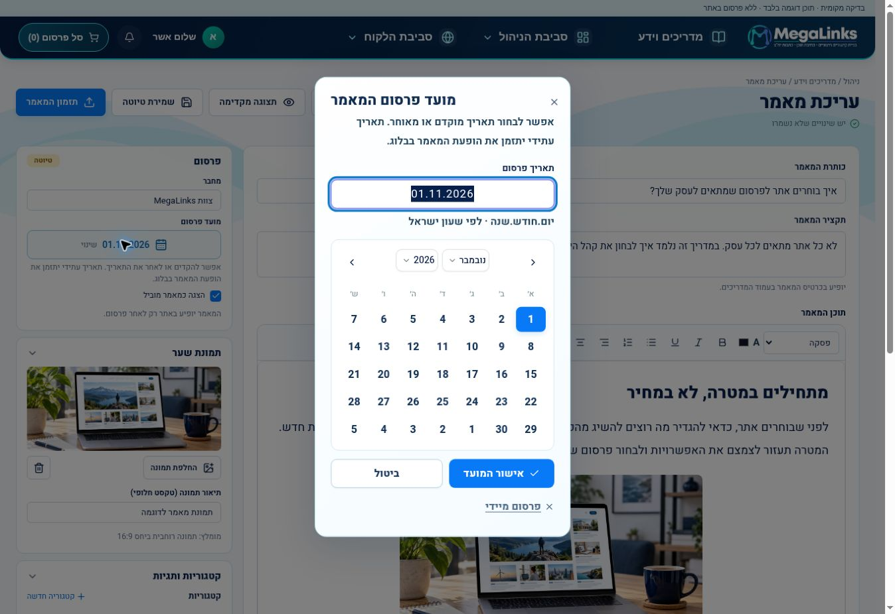

# Publication scheduling — code-only update

Builds on knowledge commit `0e3afeafaae493311ebf9b81e87ff1db40d302b5`.
Do not deploy or update the Railway staging source branch without a new request.

## Behavior

- Blog: free Hebrew calendar; earlier/later dates; explicit publish schedules
  future snapshots. Public queries, media and sitemap respect the timestamp.
- Customer: date selection is saved with the private draft. Explicit submission
  holds the article in `scheduled` until the chosen day begins in Israel.
- Example: choosing 01.11.2026 releases at 2026-10-31T22:00:00Z, subject to the
  minute poll. It reaches the manager approval queue then, not on submission day.
- Supplier delivery is still manual-approval gated. Neither scheduling nor the
  release worker creates a supplier publication job. Writing completion respects
  the same future-date hold, including the no-customer-review route.
- The customer can withdraw the scheduled submission, edit and resubmit.
- A service-key-protected internal maintenance endpoint releases due entries.
  Railway staging polls it every minute, with restart recovery from persisted D1.
  Admin GET requests provide a read-through fallback. Cancellation/payment guards,
  version claims and idempotent activity prevent early or duplicate release.
- No new migration: existing article JSON and blog publication timestamps suffice.

## Validation

Isolated built Worker/D1/R2 tests cover the approval workflow and blog dates.
No actual email, supplier message, production write or Railway deployment is used.
Browser checks use actual calendar/editor components and isolated example data.
Verified: November 1 weekday placement, typed/calendar month synchronization,
earlier/later admin changes, selected-date reopening, explicit confirm without
triggering the outer editor save, and customer past-date rejection. At 320px
the customer page and date dialog have no horizontal overflow.

